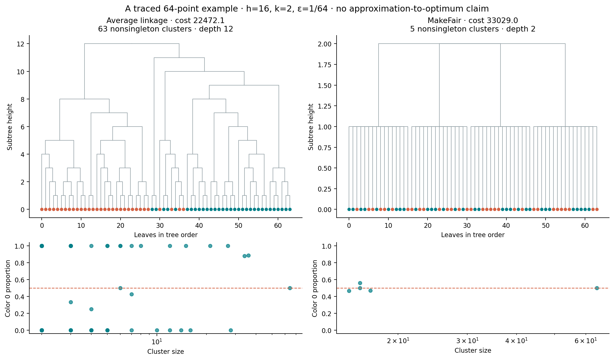

# Fair hierarchical clustering

An installable, auditable implementation of **MakeFair**, the top-down algorithm
from *Fair, Polylog-Approximate Low-Cost Hierarchical Clustering* (NeurIPS 2023).
It includes nonbinary trees, reproducible benchmarks, saved measurements, figures,
and an [interactive worked example](https://mss423.github.io/fair_hierarchical_clustering/demo.html).

The refresh follows the paper and full appendix with explicit pseudocode
corrections and finite-size terminal cases. It does **not** claim exact reproduction
of inconsistent published settings or unverified approximation guarantees.
Read the [algorithm correspondence](docs/algorithm.md) and [measured findings](docs/findings.md).



## Install and run

Python **3.11 or newer** is required. From the repository root:

```sh
python3.11 -m venv .venv
source .venv/bin/activate
python -m pip install --require-hashes -r requirements.lock
python -m pip install --no-build-isolation --no-deps -e .
fair-hc demo --output docs/demo.html
fair-hc benchmark --config configs/smoke.json --output /tmp/fair-hc-smoke
fair-hc plot --results /tmp/fair-hc-smoke --output /tmp/fair-hc-figures
pytest -q
```

The lock pins runtime, build, and development dependencies with artifact hashes.
For an ordinary unpinned installation, `python -m pip install .` suffices.
Use the [live walkthrough](https://mss423.github.io/fair_hierarchical_clustering/demo.html),
or open `docs/demo.html` locally: it embeds every trace state and needs no server or
network. It includes step controls, keyboard navigation, highlighted moves and
folds, a cluster inspector, and costs before and after the transformation.

```python
from fair_hc import average_linkage, evaluate, make_fair, similarities
from fair_hc.data import synthetic
from fair_hc.adapters import default_parameters

data = synthetic(128, seed=0, correlated=True)
w = similarities(data.features)
initial = average_linkage(w, data.labels)
result = make_fair(initial, data.labels,
                   **default_parameters(data.labels), trace=True)
metrics = evaluate(result.tree, w, data.labels,
                   bounds={"0": (0.2, 0.8), "1": (0.2, 0.8)})
print(metrics["cost"], metrics["max_representation_error"])
print(result.diagnostics["terminal_cases"])
result.tree.save("tree.json")
```

`make_fair` returns a `FairResult` with `.tree`, `.diagnostics`, and `.trace`
(`None` unless requested), also unpackable as a three-tuple. It leaves its input
unchanged. `evaluate` returns summary metrics and every nonsingleton cluster's
statistics. Optional bounds are explicit color-to-`(lower, upper)` proportions.
No theorem constants are inferred automatically.

## Reproduce the studies

All supplied inputs are local. Adult uses numerical features with White versus
other race categories; full Bank uses married versus other. See
[data provenance](docs/data-provenance.md) for missing values, row identity,
observed group proportions, and standardized sensitivity conditions.

| Profile | Coverage | Completed method-runs |
|---|---|---:|
| `smoke` | One 64-point synthetic, Adult, and Bank sample | 15 |
| `main` | Adult and Bank, n=128–8192, seeds 0–9 | 700 |
| `sensitivity` | Standardized Adult/Bank and alternate Bank mapping, n=512/2048 | 300 |
| `parameters` | Two datasets, n=512, four (h,k) pairs and two epsilons | 800 |
| `synthetic` | 2–4 colors, balanced/skewed, independent/correlated, n=256/1024 | 1,200 |
| `custom` | Runnable custom adapter and paired baseline | 2 |
| `excluded` | Published two-color h=4, k=2 | 5 exclusions |

```sh
fair-hc benchmark --config configs/main.json --output results/my-main --memory-gib 8
fair-hc benchmark --config configs/main.json --output results/my-main --resume
fair-hc plot --results results/my-main --output figures/my-main
```

Use a fresh directory when reproducing supplied results: resume requires identical
code hashes, input hashes, configuration, and dependency/platform metadata. Replace
`main` with any profile name. The five main methods are average linkage, MakeFair,
a star, splitting only, and random-group folding. Every method is paired on the
same sample and starting hierarchy. Parameter settings also share sampled rows
for the same dataset and seed.

Runs are sequential by default. The default 8 GiB budget uses a conservative
working-set estimate before allocating dense matrices and checks process peak RSS
after a method. It is **not an operating-system hard memory limit**. At n=8192 a
float64 similarity matrix alone occupies 512 MiB; this study's maximum recorded
process peak was 1.649 GiB. `--time-limit SECONDS` stops between sample groups.
Resource-limited or interrupted studies retain visible non-complete statuses;
no smaller samples are substituted. The CLI exits with code 2 for an incomplete
study. Resume retries unfinished runs; completed run directories must be preserved.

Each output directory contains:

- `manifest.json`: complete experiment schedule, configuration, environment,
  input/source hashes, and status/reason for every method-run;
- `samples/*.json`: sampled original row IDs, labels, source hashes, preprocessing,
  scaling, and seed metadata;
- `runs/*/metrics.json`: resolved parameters, metrics, stage times, peak process
  RSS, terminal cases, and split/fold diagnostics;
- `runs/*/clusters.json.gz` and `tree.json.gz`: all nonsingleton cluster statistics
  and the complete versioned nonbinary hierarchy.

Plots are generated only from saved results, in SVG, PDF, and PNG. They cover cost,
per-color distributions, representation by cluster size, parameter trade-offs,
structural balance, stage timings, multicolor conditions, ablations, depth, and
terminal-cluster resolution. Error bars use independent **seeds**, not clusters.
`python scripts/summarize_results.py` regenerates the findings tables;
`python scripts/benchmark_components.py` measures independently checked small-case
component speedups.

## What the measurements show

All **3,017 method-runs completed**, with five explicit invalid-setting exclusions.
At n=8192, MakeFair's cost divided by paired average-linkage cost was
**2.176 ± 0.017 on Adult** and **1.843 ± 0.015 on Bank** (mean ± standard error, ten
seeds). Maximum color-proportion error fell from 0.860 to 0.225 on Adult and from
0.602 to 0.237 on Bank. The transformed trees retained about 172 and 188
nonsingleton clusters, respectively, compared with 8,191 in each starting tree.

These are substantial representation gains with cost and resolution trade-offs.
Random folding had similar costs and worse representation in these cases.
A star's perfect representation score hides its complete loss of resolution.
Folding exceeded the original splitting epsilon in 222 of 603 MakeFair runs;
we measure that behavior directly. Integer infeasibility and transfer stalls are
recorded implementation extensions, not theorem-preserving claims. See the
[complete findings](docs/findings.md) and [main figures](figures/main/cost-inflation.svg).

## Custom data, starting trees, and methods

Construct `fair_hc.data.Dataset(features, labels, row_ids, metadata)` from a finite
numeric array and one label per row. Call `benchmark_adapter(dataset, seed,
parameters, starting_tree=None)` to obtain a common `Tree`. Alternatively use the
public functions above directly. `from_linkage(z, labels)` imports a SciPy linkage;
`Tree.load(path)` reads the versioned `fair-hc.tree` JSON format. Leaf IDs are
exactly `0..n-1`, corresponding to matrix rows; original dataset IDs remain in the
sample metadata. Nonbinary output is never coerced into linkage.

A custom algorithm implements:

```python
def cluster(dataset, seed, parameters, starting_tree=None):
    # Return a fair_hc.Tree with the same leaf-to-row correspondence.
    ...
```

The CLI accepts importable `module:function` entries in a configuration's `methods`
list. It hashes the adapter source and validates its output. The runnable
[example](examples/custom_algorithm.py) builds a seeded binary hierarchy:

```sh
python examples/custom_algorithm.py
PYTHONPATH=. fair-hc benchmark --config configs/custom.json --output /tmp/fair-hc-custom
```

Install your own adapter as a module, or include its directory in `PYTHONPATH`.
For new datasets, use the `Dataset` API and your own sampling/driver, or add an
explicit loader and config identifier in `fair_hc.data`; the CLI's built-in loader
names are `adult`, `bank`, and `synthetic`. Label strings must uniquely identify
colors. Global palettes stay fixed throughout the transformation.

## Restrictions, validation, and history

Require `k >= 2`, `h` divisible by `k**lambda`, `h/k**lambda >= 2`, and
`0 < epsilon < min(1/6, 1/h)`. Defaults resolve to `k=2`, `h=4*k**lambda`,
`epsilon=1/(4*h)`. Two-color `h=4, k=2` is invalid. Standalone `split_root` raises
`SplitInfeasible` on integer failures; MakeFair logs the reason and terminates that
subtree as a star. Trace snapshots are for small demonstrations and can be large.

Tests cover invariants, independent pairwise-LCA costs, average-linkage equivalence,
tied/duplicate inputs, missing local colors, skewed trees, integer stalls,
serialization, input immutability, sampling, custom adapters, resume, and plotting.
CI runs Python 3.11 and 3.13. The local validation record is in
[docs/validation.md](docs/validation.md). Optional browser verification uses
`scripts/check_demo.mjs` with Playwright installed separately.

Historical code and notices remain in [legacy/](legacy/PROVENANCE.md), with
SHA-256 manifests. The supplied PDF remains unchanged in `lit/`. Read the
[migration guide](docs/migration.md) before using old entry points. The recovered
supplement is archival material with its own provenance and is excluded from the
Python distribution.

## Citation

See [CITATION.cff](CITATION.cff). Cite Knittel, Springer, Dickerson, and Hajiaghayi,
“Fair, Polylog-Approximate Low-Cost Hierarchical Clustering,” *Advances in Neural
Information Processing Systems* 36, 44836–44846, 2023
([paper and full appendix](https://arxiv.org/abs/2311.12501)). Describe the corrections
and finite-size extensions when reporting results from this package.
